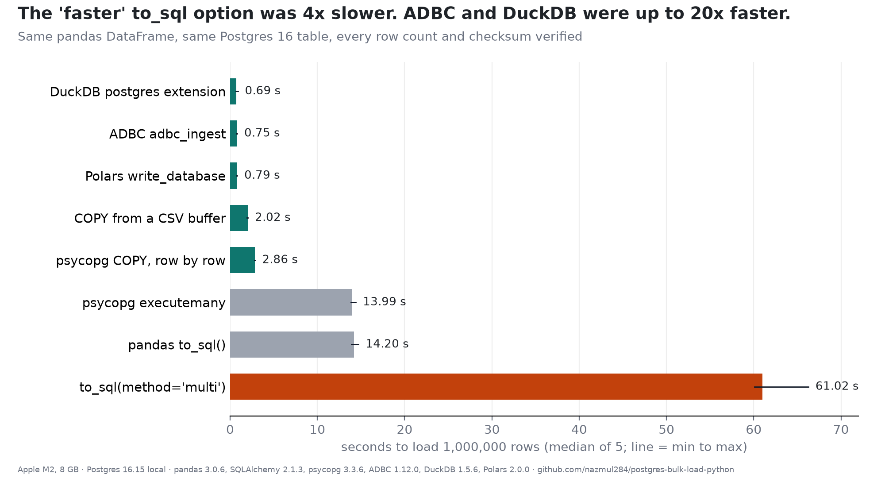

# postgres-bulk-load-python

Eight ways to load the same pandas DataFrame into the same Postgres 16 table, timed (5 runs at 1M rows, 2 at 10M) and verified by row count and checksums. Companion to *pandas to_sql(method="multi") Was 4x Slower: 8 Ways to Load 1M Rows Into Postgres, Timed*.



## Results

```
1,000,000 rows from a pandas DataFrame, median of 5 runs

method                      seconds     rows/s    vs to_sql  extra MB
-------------------------   -------  ---------  -----------  --------
to_sql(method='multi')        61.02     16,389  4.3x slower       266
pandas to_sql()               14.20     70,442         1.0x       726
psycopg executemany           13.99     71,500         1.0x       340
psycopg COPY write_row         2.86    349,650         5.0x         3
COPY from to_csv buffer        2.02    496,032         7.0x        53
Polars write_database          0.79  1,273,885        18.1x       123
ADBC adbc_ingest               0.75  1,333,333        18.9x        69
DuckDB postgres ext            0.69  1,447,178        20.5x       108


10,000,000 rows, median of 2 runs

method                      seconds     rows/s  extra MB
-------------------------   -------  -----------  --------
psycopg COPY write_row        28.70    348,390        39
COPY from to_csv buffer       21.14    473,149       230
Polars write_database         11.25    888,612       932
DuckDB postgres ext            8.68  1,151,477       688
ADBC adbc_ingest               7.14  1,399,580       477
```

## Reproduce

```
uv venv -p 3.13 .venv && uv pip install -r requirements.txt
# needs a local Postgres on port 5499 with user 'bench' and database 'load' (see harness/load.py DSN)
python harness/run_all.py && python harness/analyze.py
bash harness/clean_round.sh     # one extra round with nothing else running
```

Measured on an 8 GB Apple M2, macOS, 7 October 2026. Absolute times are properties of this
laptop; the ratios between methods are what should travel.

## License

MIT
